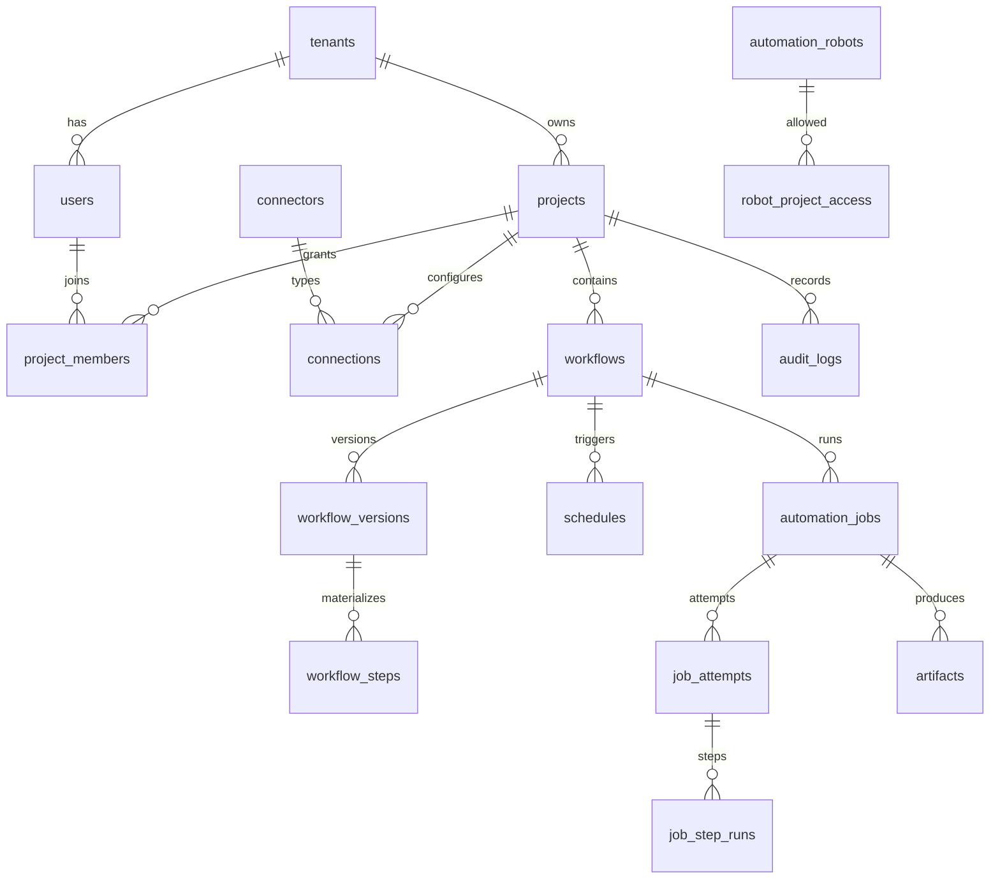

# Architecture

URAP separates a workflow definition, a published version, a queued job, an execution attempt, and the attempt's step results.

## Components

1. The React application calls the API. It cannot set a job status directly.
2. Express modules enforce validation, tenant scope, and role checks.
3. MySQL stores projects, versions, the queue, attempts, artifacts, and audit rows.
4. `workflow/validate.js` rejects unknown steps, raw SQL, shell fields, and unbounded loops.
5. Connectors expose REST, Excel, CSV, PDF text, files, allow-listed MySQL, browser-through-robot, and SMTP.
6. The worker claims native jobs and runs the engine. HTTP requests only enqueue work.
7. UiPath integration is a file handoff plus an authenticated robot API. Orchestrator is used only when its base URL, token, and release key are all configured, and this build does not call it unless those values exist.
8. The scheduler stores `next_run_at` and skips a new run when `overlap_policy` is `skip` and a previous job is still active.
9. Attempts and `job_step_runs` are the execution log.
10. JWT access tokens and hashed refresh tokens authenticate users. Robots use a separate hashed token and a project allow list.
11. Artifacts live under the project storage root. Download checks project membership and rejects paths outside that root.

## Queue trade-off

The first queue is the `automation_jobs` table. A worker updates a row from `QUEUED` to `CLAIMED` only while the status is still `QUEUED`, inside a transaction, then moves it to `RUNNING`. This needs no extra service, stays consistent with the job record, and can be inspected with SQL. Polling adds a short delay and will not match a dedicated broker at very high volume. The claim function is the replacement point if Redis or another broker is added later.

## State transitions

`DRAFT -> QUEUED|CANCELLED`

`QUEUED -> CLAIMED|CANCELLED|SKIPPED`

`CLAIMED -> RUNNING|CANCELLED|FAILED`

`RUNNING -> SUCCEEDED|FAILED|CANCEL_REQUESTED|RETRY_WAIT`

`CANCEL_REQUESTED -> CANCELLED|FAILED`

`RETRY_WAIT -> QUEUED|CANCELLED`

`FAILED -> QUEUED` for an operator retry. The previous `job_attempts` row is kept and the next claim inserts a new attempt number.

A scheduled overlap creates a `SKIPPED` job record so the history shows that no execution happened.
